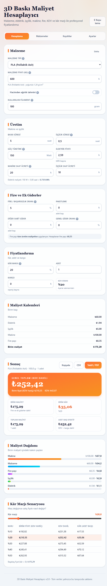

# 3D Baskı Maliyet Hesaplayıcı

> Profesyonel 3D baskı fiyatlandırma aracı — malzeme, elektrik, işçilik, makine,
> fire payı, KDV ve kâr marjını hesaba katar; müşteriye sunulabilir fiyat teklifi üretir.

<p align="center">
  <a href="https://mryusufcan.github.io/3d-maliyet-hesaplayici/"><strong>🌐 Canlı Demo</strong></a>
  ·
  <a href="#kullanım">Kullanım</a>
  ·
  <a href="#maliyet-formülü">Formül</a>
  ·
  <a href="#yerel-geliştirme">Geliştirme</a>
</p>



## Öne Çıkanlar

- **Tek dosya, kurumsuz:** 308 KB'lık tek HTML dosyası. İnternet gerekmez, çift tıkla açılır.
- **Şeffaf maliyet dökümü:** Malzeme, elektrik, işçilik, makine, fire payı ve genel gider
  kalemleri ayrı ayrı gösterilir.
- **Fire/başarısızlık payı:** İstenirse tüm üretim maliyetine, istenirse yalnızca malzemeye uygulanır.
- **Hacim modu:** Dilimleyici gramı yoksa model hacmi (cm³) × doluluk × yoğunluk ile ağırlık tahmini.
- **Kâr marjı senaryoları:** %10–50 tablosu, sürgü ve başabaş (kâr = 0) fiyatı.
- **Adet + kargo + KDV:** Sipariş toplamı, KDV dahil genel toplam ve adet başı efektif fiyat.
- **Kayıtlı hesaplar:** Sık kullanılan ayarları kaydet/yükle, JSON yedek al-dön.
- **Çıktılar:** Excel uyumlu CSV, panoya özet, yazdırılabilir fiyat teklifi (PDF).
- **Koyu tema** ve mobil uyumlu arayüz; tüm veriler yalnızca tarayıcıda (localStorage) saklanır.

## Kullanım

1. [Canlı demo](https://mryusufcan.github.io/3d-maliyet-hesaplayici/) açılır ya da `index.html`
   dosyası indirilip çift tıklanır.
2. **Malzemeler** sekmesinden kendi alış fiyatların girilir.
3. **Hesaplama** sekmesinde baskının gram/saat bilgileri girilir.
4. **Kayıtlılar** sekmesinden sık kullanılan profiller kaydedilir.

## Maliyet Formülü

```
malzeme    = ağırlık(g) / 1000 × kgFiyatı
elektrik   = watt × baskıSaati / 1000 × kWhFiyatı
işçilik    = hazırlıkSaati × saatlikÜcret        (baskı süresinden bağımsız)
makine     = baskıSaati × saatlikÜcret           (amortiman + bakım)
üretim     = malzeme + elektrik + işçilik + makine
fire       = üretim × fireOranı                  (veya yalnızca malzeme × fireOranı)
birimMaliyet = üretim + fire + paketleme + diğer + bu toplam × genelGiderOranı
satışFiyatı  = birimMaliyet × (1 + kârMarjı)
genelToplam  = satışFiyatı × adet × (1 + KDV) + kargo
```

## Yerel Geliştirme

```bash
npm install
npm run dev          # geliştirme sunucusu (hot reload)
npm test             # 38 birim testi (vitest)
npm run build:single # tek dosyalık çıktı -> dist-single/index.html
npm run build        # çok dosyalı çıktı -> dist/
```

Demo sayfasını güncellemek için `dist-single/index.html` içeriğinin depodaki
`index.html` dosyasına yazılması yeterli. GitHub Pages otomatik olarak yeniden yayınlar.

## Teknoloji

| Katman | Seçim |
| --- | --- |
| Arayüz | React 19 + TypeScript |
| Stil | Tailwind CSS 4 |
| Derleme | Vite + `vite-plugin-singlefile` |
| Test | Vitest (hesap motoru için 38 birim testi) |

## Lisans

[MIT](LICENSE) — ticari kullanım serbesttir.
